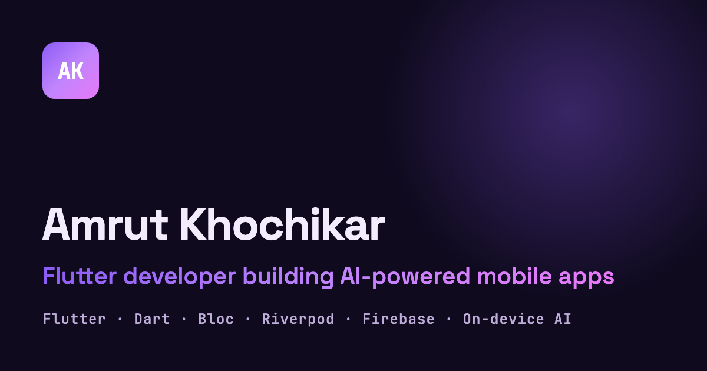

# Amrut Khochikar — Portfolio

Single-page Flutter web portfolio for **Amrut Khochikar**, a Flutter developer building AI-powered mobile apps.

**Live:** https://amrut-portfolio-project.web.app



## Features

- Dark, animated design (particle background, scroll reveals, hover/focus effects) that respects *reduced motion*
- Responsive mobile / tablet / desktop layouts
- Deep links to sections (`/#projects`), selectable text, keyboard-accessible controls
- Contact form → Cloud Firestore (`messages`), protected by Firestore rules + optional App Check, with an email fallback
- Resume download, SEO meta tags, JSON-LD, social share image, branded splash

## Tech stack

Flutter (web), Firebase Hosting, Cloud Firestore, Firebase App Check, `url_launcher`, `package:web`. Fonts (Inter, Space Grotesk, JetBrains Mono) are bundled in `assets/fonts`.

## Getting started

The Flutter version is pinned in `.fvmrc`.

```bash
fvm install && fvm flutter pub get
fvm flutter run -d chrome
```

## Project layout

```
lib/
  core/        content (portfolio_data.dart), models, anchors, browser helpers
  sections/    one widget per page section
  widgets/     shared UI (Pressable, HoverCard, GradientButton, SectionShell, …)
  theme/       colors, typography, breakpoints
tool/          generate_brand_assets_test.dart: renders icons / favicon / og-image
```

To update the site content, edit `lib/core/portfolio_data.dart`.

## Brand assets

```bash
flutter test tool/generate_brand_assets_test.dart   # writes web/icons, web/favicon.png, web/og-image.png
```

## Build & deploy

```bash
flutter build web --release --wasm --dart-define=RECAPTCHA_SITE_KEY=<site key>
firebase deploy --only hosting,firestore:rules
```

CI (`.github/workflows/ci.yml`) runs format, analyze and tests on every push / PR, deploys PR previews, and deploys `main` live. It needs these repository secrets:

| Secret | Purpose |
| --- | --- |
| `FIREBASE_SERVICE_ACCOUNT` | Service account JSON (`firebase init hosting:github` creates it) |
| `RECAPTCHA_SITE_KEY` | reCAPTCHA v3 site key registered in Firebase App Check (optional) |

## Testing

```bash
flutter test test
```

Covers hero content, responsive nav, nav scrolling, contact form validation, and layout-overflow checks from 360px to 1920px.
